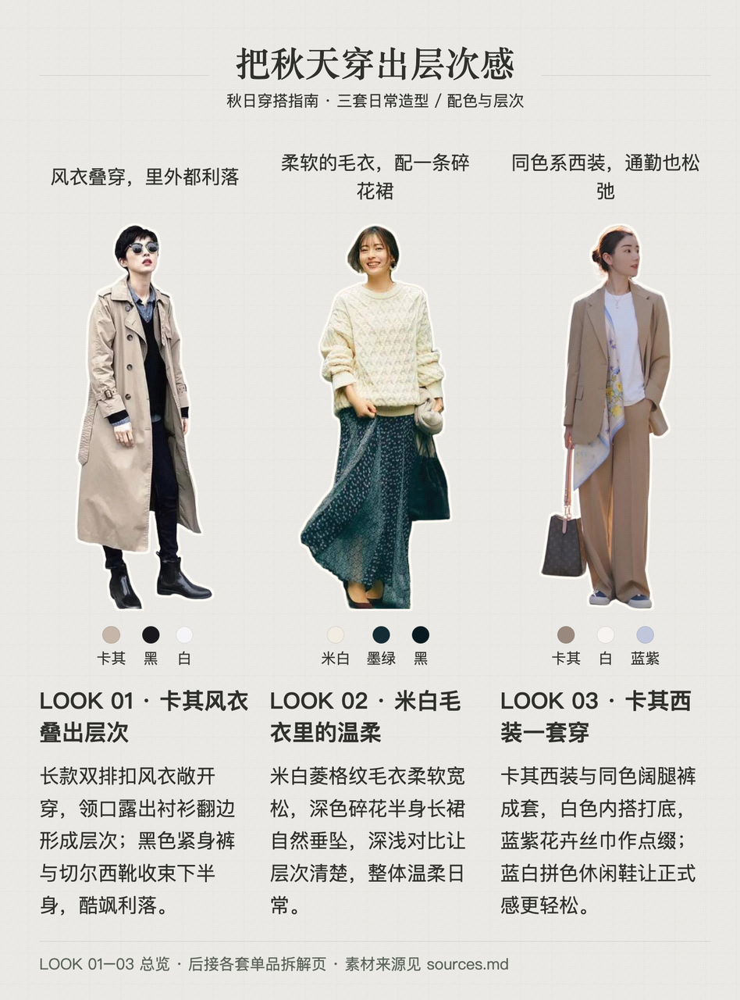
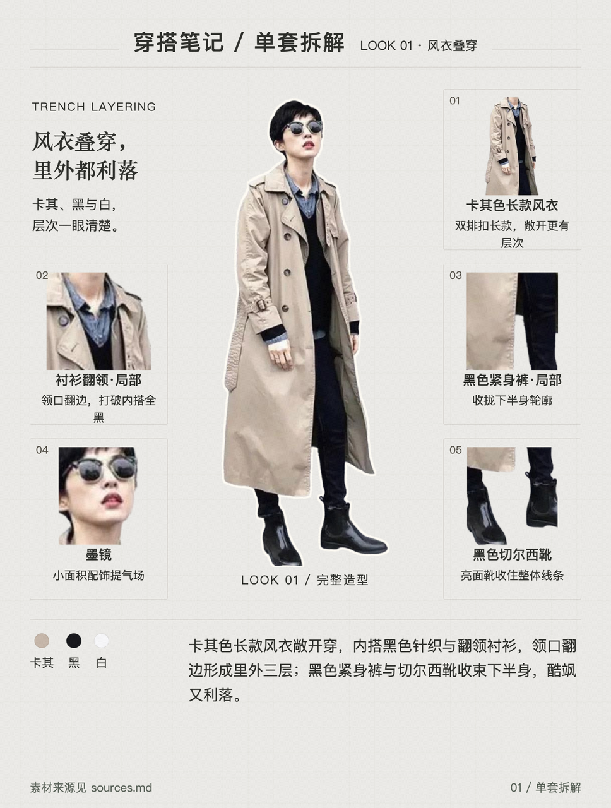
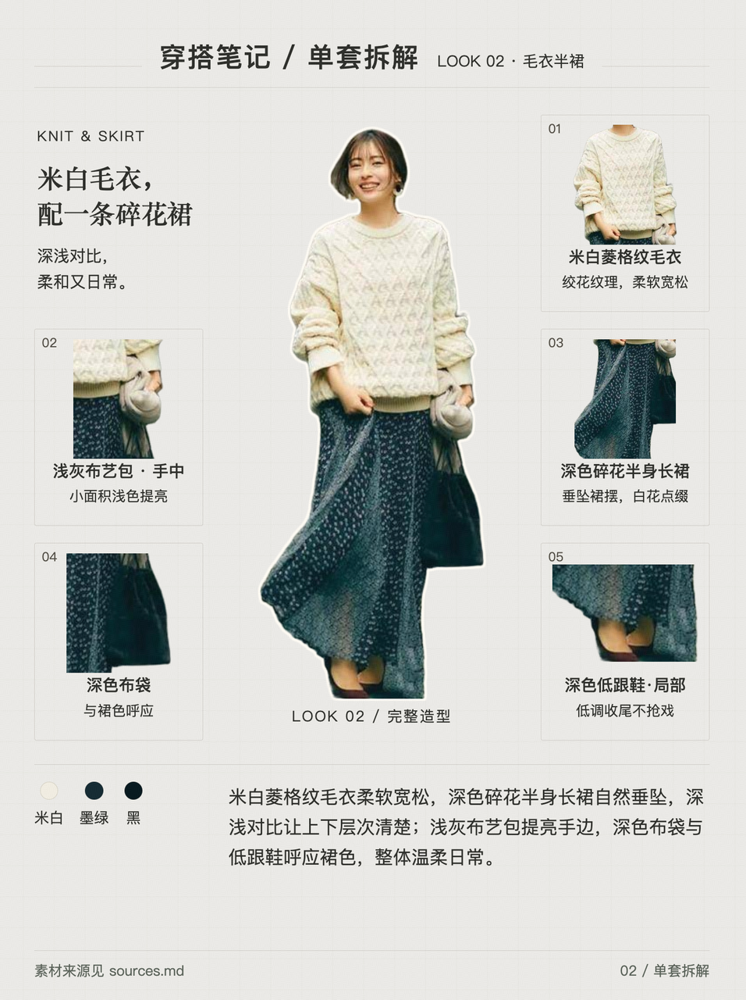
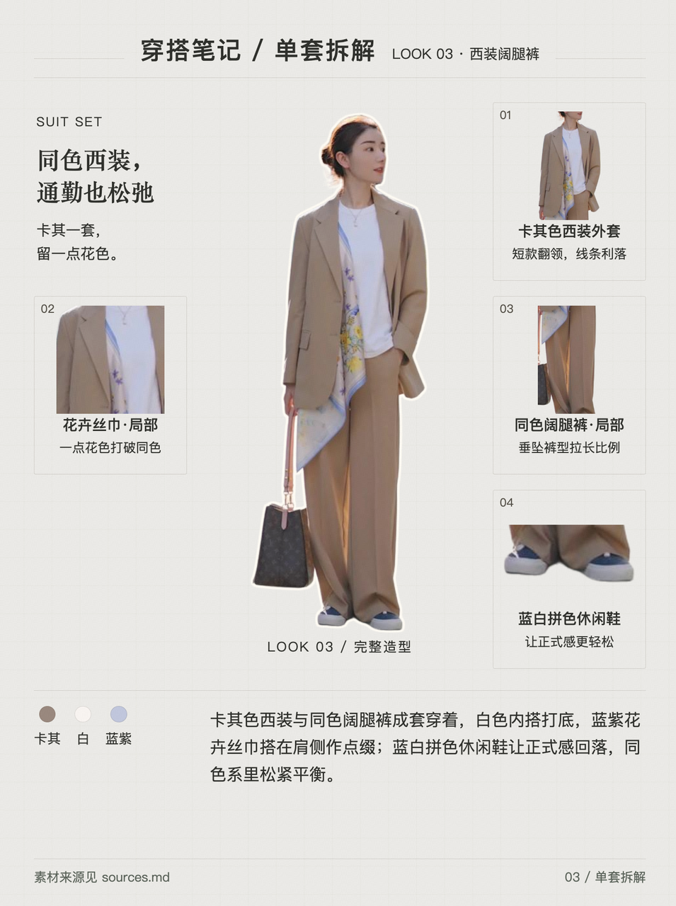

# 秋日穿搭指南

多套穿搭总览与单套拆解，统一中性背景、服装抠图与配色说明。

- [任务提示词](prompt.md)
- [图片结果](result/)
- [原始生成会话](https://www.doubao.com/thread/xhBlKTnPmw5K66Hc7)（访问可能需要登录）

## 输入与使用

输入为文字任务，配图由生成时联网检索取得；未附原始服装图片与检索记录。

本案例保存可直接查看的图片快照，未提供可编辑 HTML 或完整素材包。无需安装依赖即可在 GitHub 或浏览器中打开图片；也可下载原尺寸查看正文。图片与其中的第三方照片、文字不因收录而获得额外使用授权。

在安装 [editorial-magazine](../../../skills/editorial-magazine/SKILL.md) 的 Agent 中提供 `prompt.md` 与所需材料，可制作同类作品。生成 PNG 需要 Python 3.10+、Skill 的 `requirements.txt` 与 Chromium/Chrome；搜图、生成与抠图由宿主提供。

## 图片结果

1. [三套造型总览](result/01.webp)（预览见上方）

### 2. 风衣造型拆解

### 3. 针织衫造型拆解

### 4. 西装造型拆解

