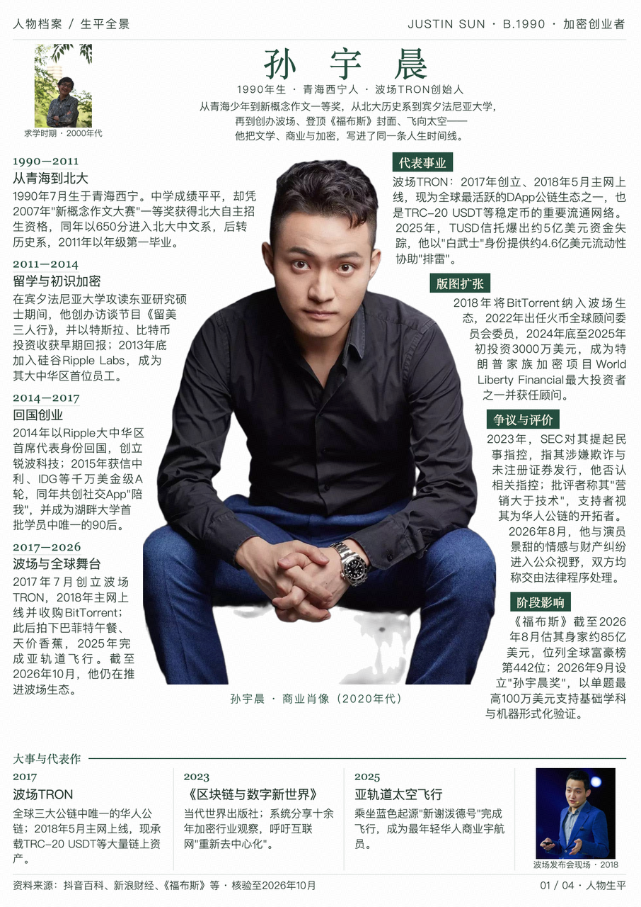
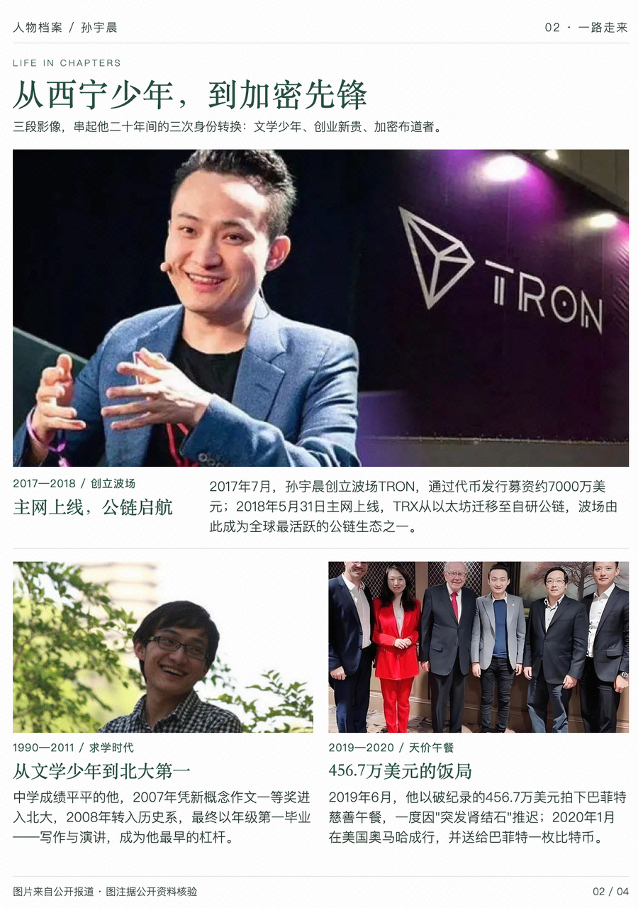
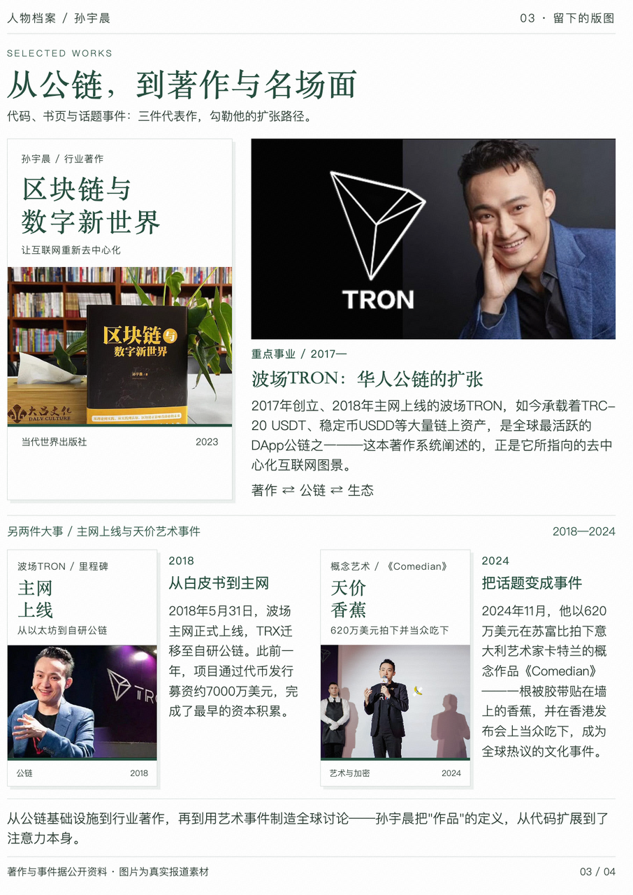
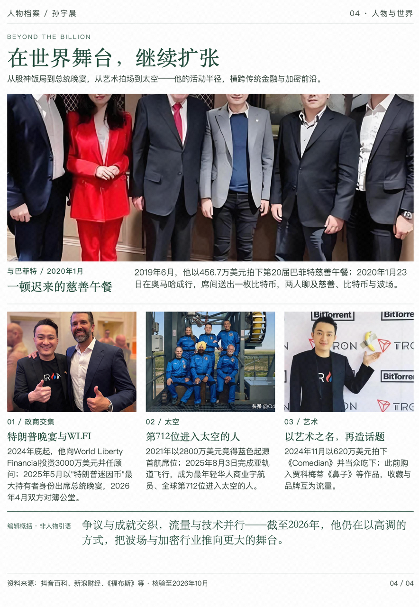

# 孙宇晨人物生平组图

人物全景主图与多图详情，兼顾连续正文、经历、代表项目与社会活动。

- [任务提示词](prompt.md)
- [图片结果](result/)
- [原始生成会话](https://www.doubao.com/thread/x8MM5gUZWebGbh6IN)（访问可能需要登录）

## 输入与使用

未附原始人物资料、照片与事实核验记录；图片用于展示排版，人物近况、争议和项目数据需另行核实。

本案例保存可直接查看的图片快照，未提供可编辑 HTML 或完整素材包。无需安装依赖即可在 GitHub 或浏览器中打开图片；也可下载原尺寸查看正文。图片与其中的第三方照片、文字不因收录而获得额外使用授权。

在安装 [editorial-magazine](../../../skills/editorial-magazine/SKILL.md) 的 Agent 中提供 `prompt.md` 与所需材料，可制作同类作品。生成 PNG 需要 Python 3.10+、Skill 的 `requirements.txt` 与 Chromium/Chrome；搜图、生成与抠图由宿主提供。

## 图片结果

1. [人物全景](result/01.webp)（预览见上方）

### 2. 成长经历

### 3. 项目与作品

### 4. 人物与世界

