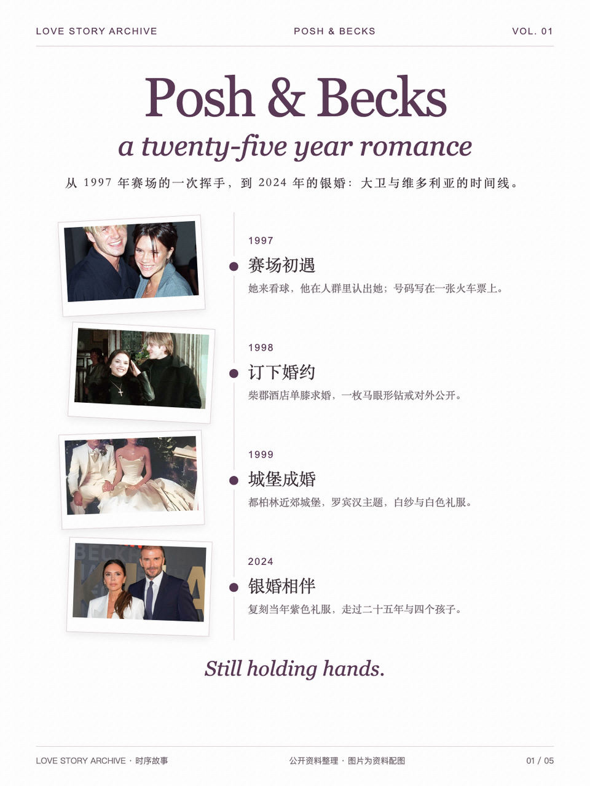
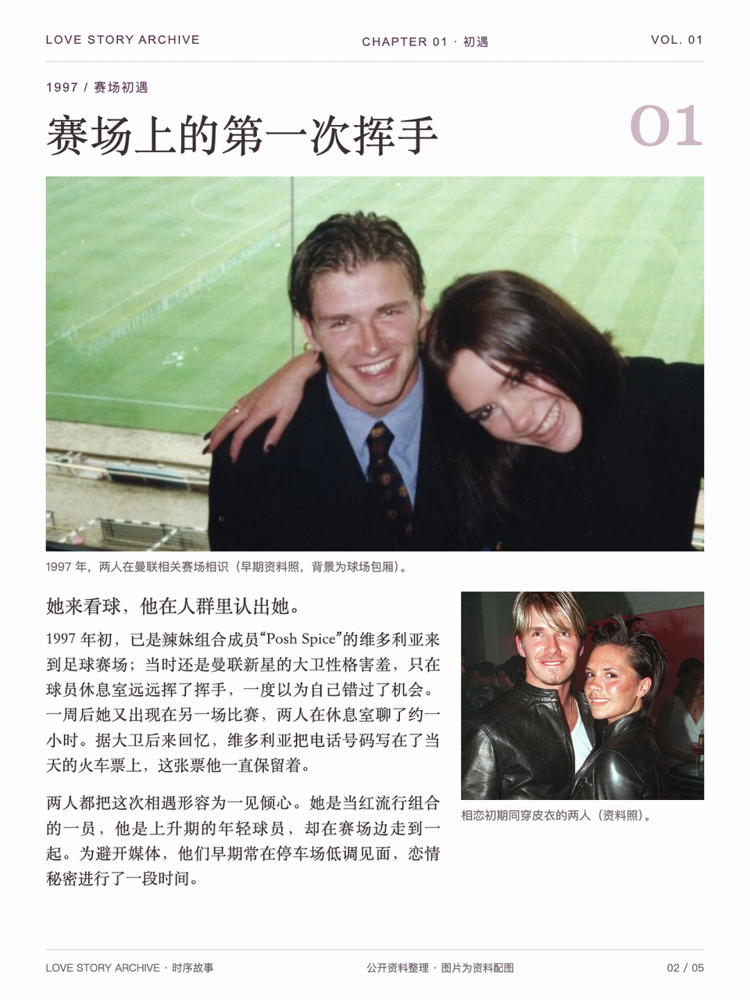
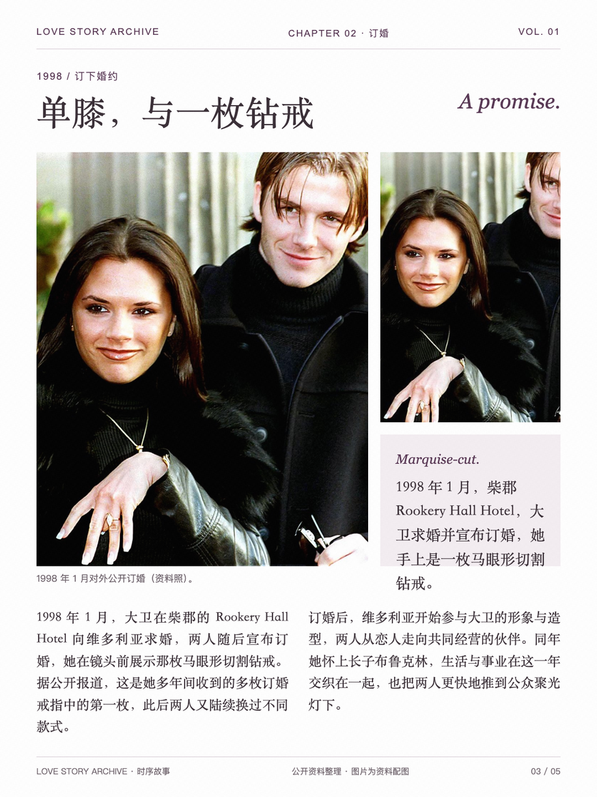
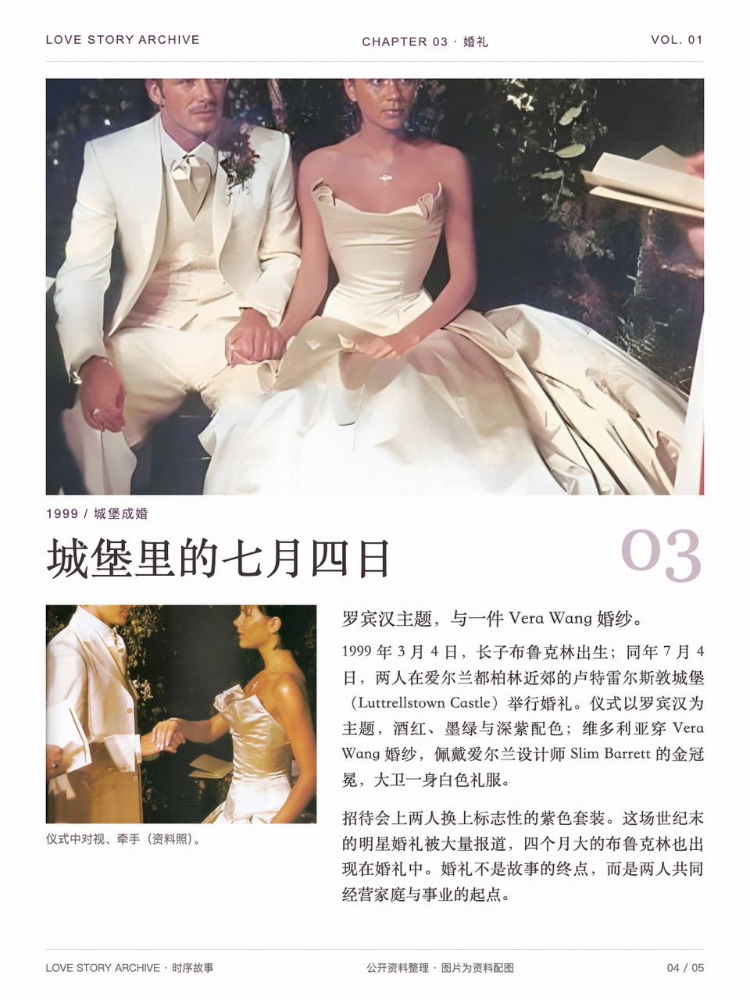
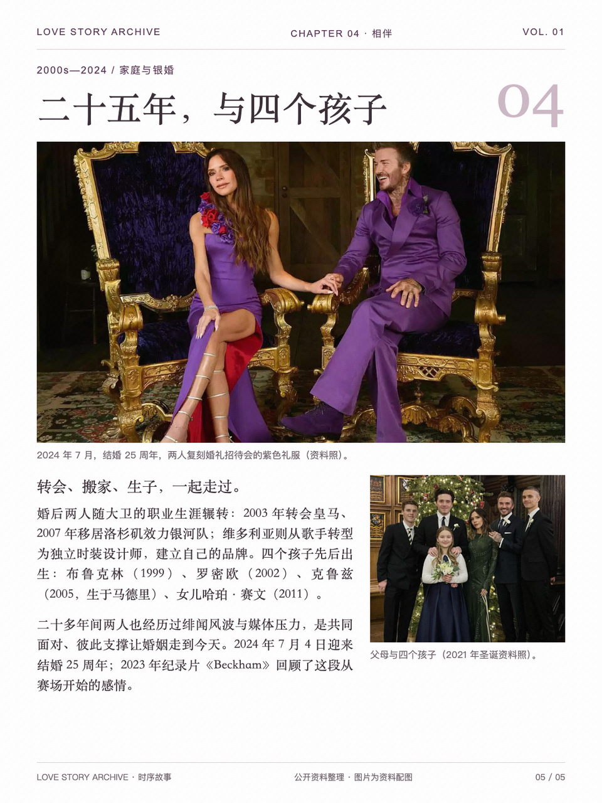

# 名人爱情故事：按时间展开

以贝克汉姆夫妇为例，用概览页与逐节点图文组织时序叙事。

- [任务提示词](prompt.md)
- [图片结果](result/)
- [原始生成会话](https://www.doubao.com/thread/xD0MzxqMqlUBTPETg)（访问可能需要登录）

## 输入与使用

未附原始照片、人物史料和可编辑源稿；这是历史生成的叙事排版示例，日期、引语与人物近况需另行核验。

本案例保存可直接查看的图片快照，未提供可编辑 HTML 或完整素材包。无需安装依赖即可在 GitHub 或浏览器中打开图片；也可下载原尺寸查看正文。图片与其中的第三方照片、文字不因收录而获得额外使用授权。

在安装 [editorial-magazine](../../../skills/editorial-magazine/SKILL.md) 的 Agent 中提供 `prompt.md` 与所需材料，可制作同类作品。生成 PNG 需要 Python 3.10+、Skill 的 `requirements.txt` 与 Chromium/Chrome；搜图、生成与抠图由宿主提供。

## 图片结果

1. [故事概览](result/01.webp)（预览见上方）

### 2. 相遇

### 3. 订婚

### 4. 婚礼

### 5. 家庭与岁月

