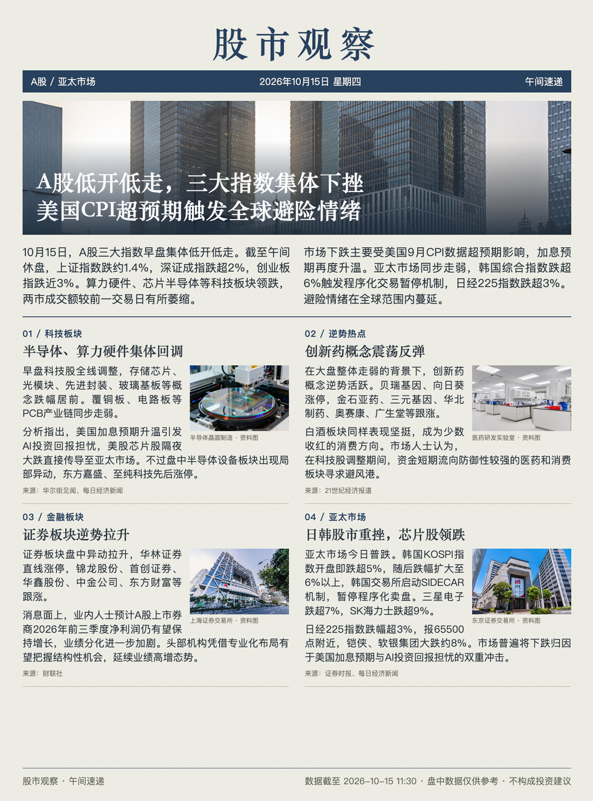
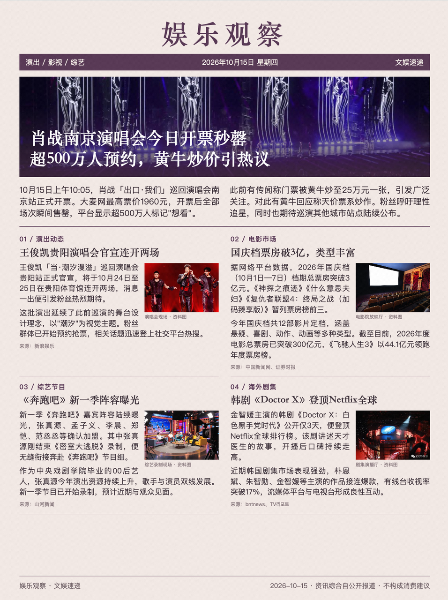
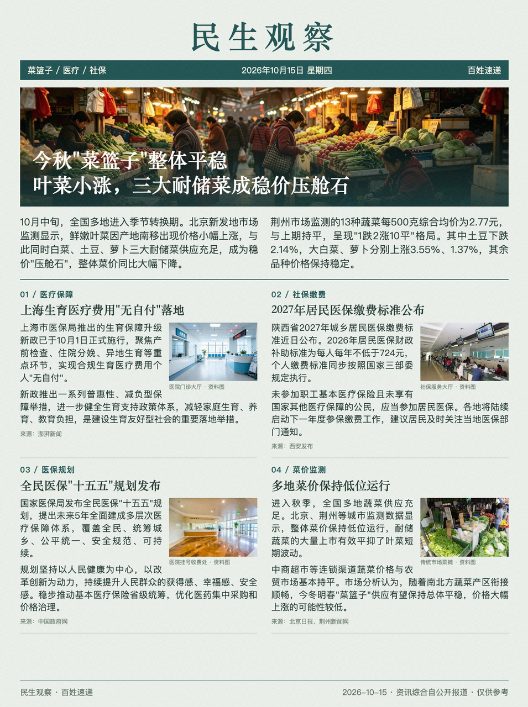
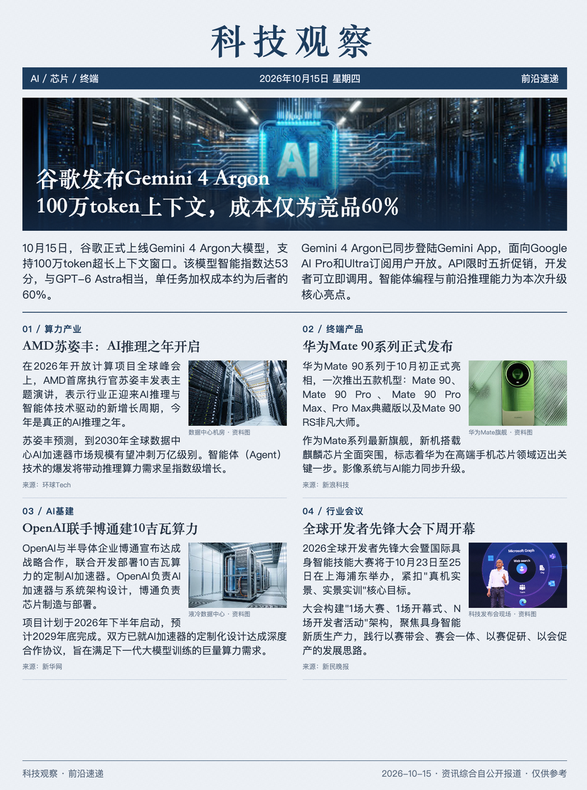

# 四类新闻资讯排版

股市、娱乐、民生与科技的报刊式信息组织：主新闻、配图、分栏与简讯。

- [任务提示词](prompt.md)
- [图片结果](result/)

## 输入与使用

四条提示词分别对应四次生成。图片是历史生成结果，“今日”指原任务执行时，并非浏览时的实时新闻；新闻事实与行情未在本案例中重新核验，不能作为新闻或投资信息来源。未附原始新闻输入。

本案例保存可直接查看的图片快照，未提供可编辑 HTML 或完整素材包。无需安装依赖即可在 GitHub 或浏览器中打开图片；也可下载原尺寸查看正文。图片与其中的第三方照片、文字不因收录而获得额外使用授权。

在安装 [editorial-magazine](../../../skills/editorial-magazine/SKILL.md) 的 Agent 中提供 `prompt.md` 与所需材料，可制作同类作品。生成 PNG 需要 Python 3.10+、Skill 的 `requirements.txt` 与 Chromium/Chrome；搜图、生成与抠图由宿主提供。

## 图片结果

1. [股市资讯](result/01.webp)（预览见上方）

### 2. 娱乐头条

### 3. 民生头条

### 4. 科技头条

## 生成会话

- [股市资讯](https://www.doubao.com/thread/x9GEELu7dgvlJJMSb)
- [娱乐头条](https://www.doubao.com/thread/xxsJizSUHNp0WQpmc)
- [民生头条](https://www.doubao.com/thread/xuDlBwI6Nue2acoI4)
- [科技头条](https://www.doubao.com/thread/xzQp8rnzJ79Ejx6Zb)
