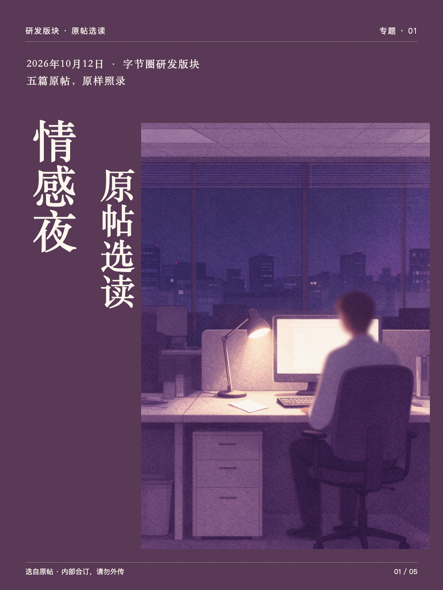
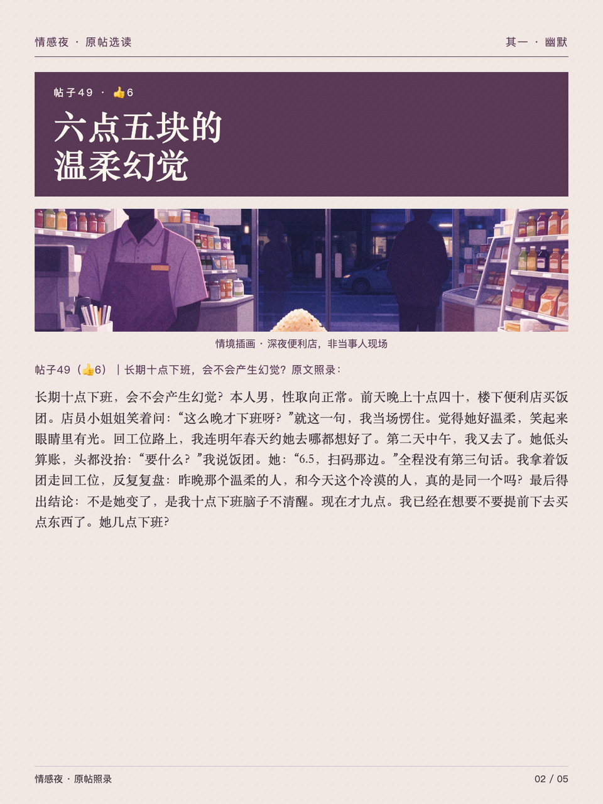
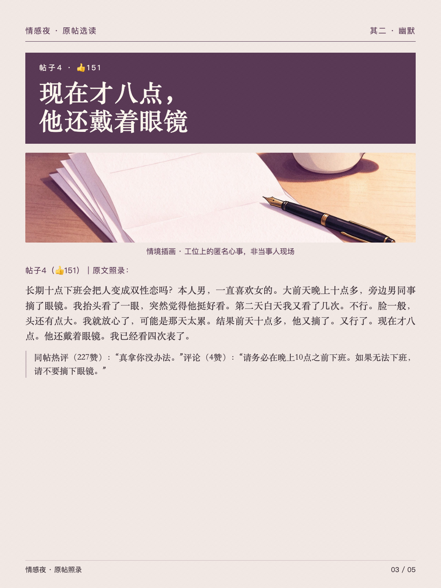
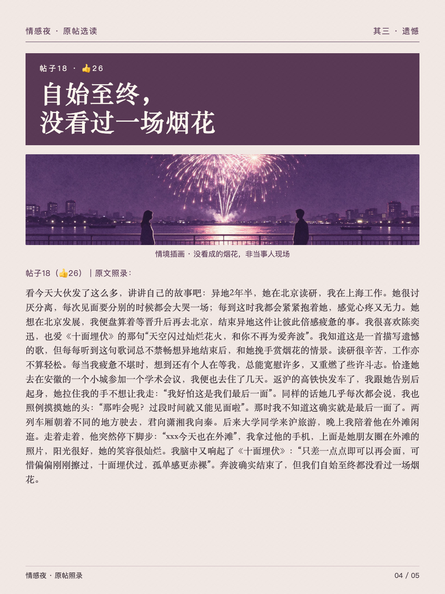
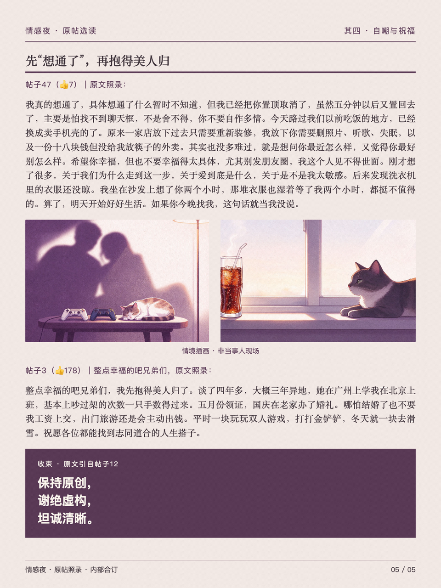

# 情感夜读：原帖选读

保留原文的观点编辑与多页专题，使用统一色调、栏目标题和长文阅读版式。

- [任务提示词](prompt.md)
- [图片结果](result/)

## 输入与使用

原始帖子文档未随案例公开，提示词中的文档地址以输入占位说明替换。使用时提供自己有权使用的文字；缺少原始输入，不能完整复现这组图。

本案例保存可直接查看的图片快照，未提供可编辑 HTML 或完整素材包。无需安装依赖即可在 GitHub 或浏览器中打开图片；也可下载原尺寸查看正文。图片与其中的第三方照片、文字不因收录而获得额外使用授权。

在安装 [editorial-magazine](../../../skills/editorial-magazine/SKILL.md) 的 Agent 中提供 `prompt.md` 与所需材料，可制作同类作品。生成 PNG 需要 Python 3.10+、Skill 的 `requirements.txt` 与 Chromium/Chrome；搜图、生成与抠图由宿主提供。

## 图片结果

1. [专题封面](result/01.webp)（预览见上方）

### 2. 选读一

### 3. 选读二

### 4. 选读三

### 5. 选读四

