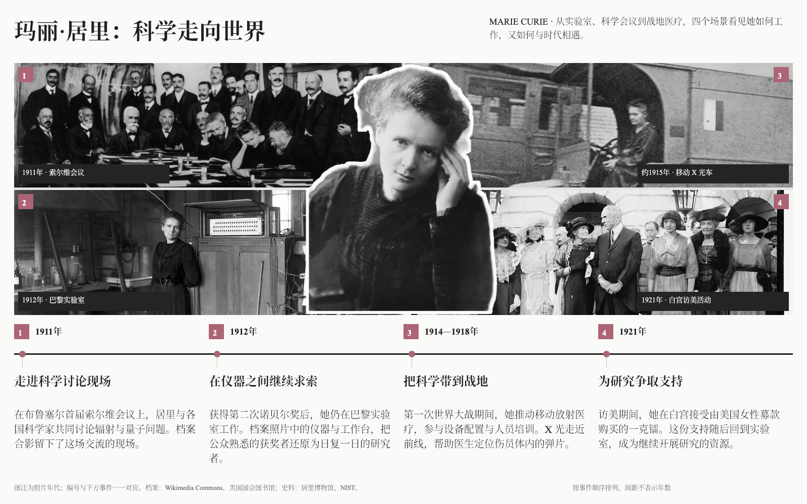
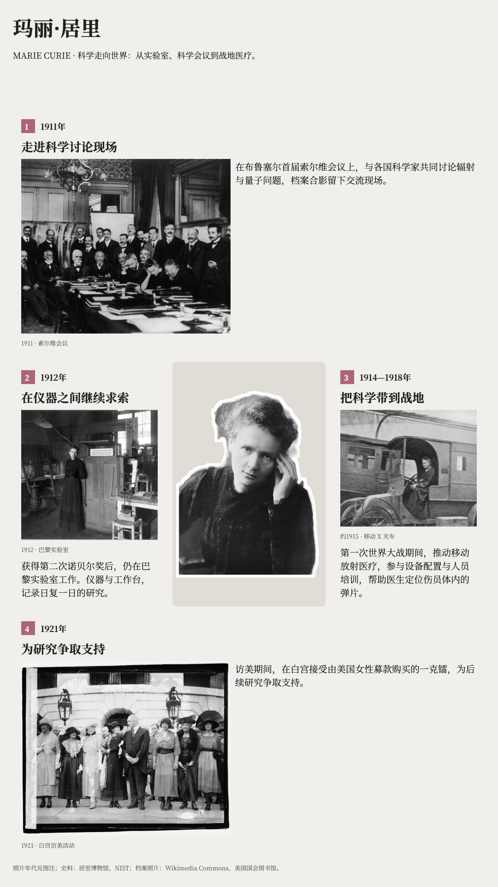
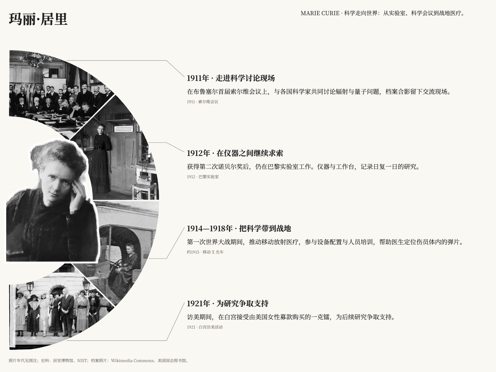

# 居里夫人：三种人物志版式

用同一组人物史料与照片比较照片墙＋时间线、中心网格和环形叙事，展示人物抠图、事件配图与时间节点的对应关系。

- [复现提示词](prompt.md)
- [三张图片结果](result/)

## 输入与使用

围绕1911年索尔维会议、1912年巴黎实验室、一战期间的移动放射医疗和1921年访美四个节点。这三张图片由本地 Skill 构建与渲染脚本生成，不能据此认为已验证宿主的完整搜图、抠图流程。

本案例仅保存图片结果，未附可编辑 HTML、schema 或原始图片包，不能逐像素复现。可直接在 GitHub／浏览器查看，下载后放大阅读正文。在安装 [life-chronicle](../../../skills/life-chronicle/SKILL.md) 的 Agent 中提供 `prompt.md`，重新准备资料和照片，生成同类海报。导出需 Python 3.10+、Skill 的 `requirements.txt` 与 Chromium/Chrome，具体见 [环境要求](../../../skills/life-chronicle/references/environment.md)。

## 资料与图片

- [主肖像：约1900年](https://commons.wikimedia.org/wiki/File:Marie_Curie_1900_-_DIG17379.jpg)
- [1911年索尔维会议](https://commons.wikimedia.org/wiki/File:1911_Solvay_conference.jpg)
- [1912年巴黎实验室](https://commons.wikimedia.org/wiki/File:Marie_Curie_in_her_Paris_Laboratory,_1912.jpg)
- [移动 X 光车](https://commons.wikimedia.org/wiki/File:Marie_Curie_-_Mobile_X-Ray-Unit.jpg)
- [1921年与哈定会面](https://commons.wikimedia.org/wiki/File:Harding_%26_Marie_Curie,_5-20-21_LOC_npcc.04183.jpg)
- [NIST：1921年访美](https://www.nist.gov/pml/marie-curie-and-nbs-radium-standards/1921-marie-curie-visits-us)

作品使用裁切、灰度、人物去背景与白色描边；照片年代与事件年代分别核对，素材权利信息以各来源页为准。

## 中心网格（竖版）

## 环形叙事（横版）

