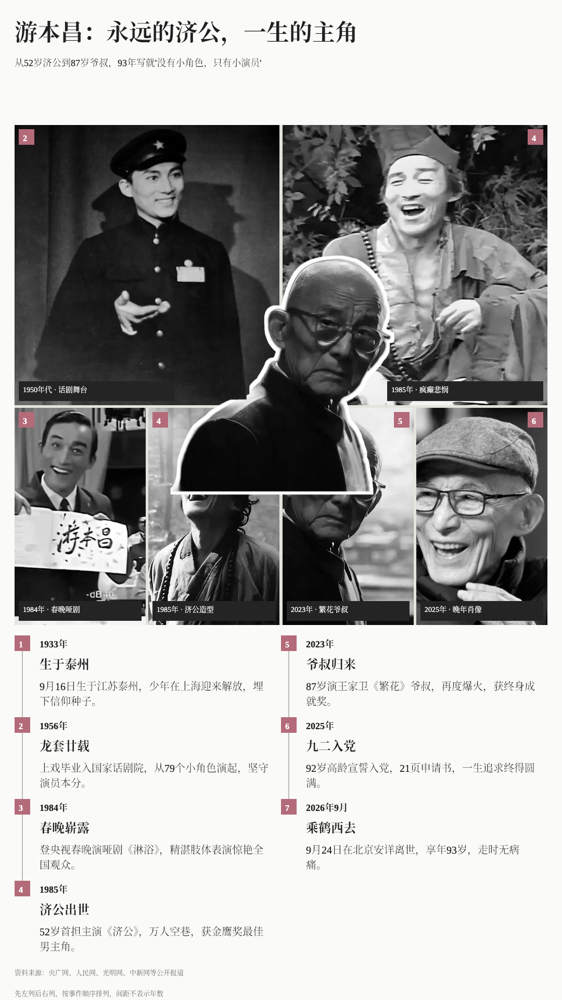

# 游本昌：竖版照片墙人物志

原始提示词含未经本案例核验的去世消息，只作为历史输入保留，不代表已确认该消息；再次制作时先核实人物近况。

- [原始提示词](prompt.md)
- [图片结果](result/poster.webp)
- [生成会话](https://www.doubao.com/thread/xmagy4Tj9gud7VpCw)（访问可能需要登录）

## 输入与使用

这是历史生成结果的展示，未对图中的人物近况、日期和引语重新核验，不作为人物资料或新闻来源。未附完整原始材料、可编辑 HTML 或 schema，不能完整复现；第三方照片的权利不随本案例额外授予。

图片可以直接在 GitHub 或浏览器查看，下载后放大阅读。在安装 [life-chronicle](../../../skills/life-chronicle/SKILL.md) 的 Agent 中提供提示词与已核实的事件、照片，可制作同类海报。生成 PNG 需要 Python 3.10+、Skill 的 `requirements.txt` 与 Chromium/Chrome；详见 [环境要求](../../../skills/life-chronicle/references/environment.md)。
